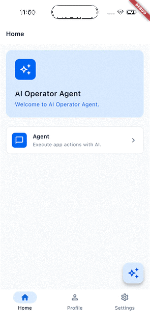

# Flutter App Copilot

This package lets your app's users prompt AI so it can **execute actions and operations inside your app**, such as:

- **"Turn on dark mode"** → change an app setting.
- **"Change my name to Maya"** → update a profile.
- **"Take me to my orders"** → navigate to a screen.

You define the actions your app exposes. The package connects to **Gemini,
OpenAI, or Claude**, runs model-requested actions through your handler, and
returns the model's final reply. Your app keeps control of its business rules,
data, and UI.

## Demo

<table>
  <tr>
    <td align="center" width="320">
      
    </td>
    <td valign="middle">
      <p>In this demo, a user chats with the in-app agent and the app responds:</p>
      <ol>
        <li><b>"Turn dark mode on"</b> switches the app's theme.</li>
        <li><b>"Change my name to Joe"</b> updates the profile and confirms the change.</li>
      </ol>
      <p>Each request runs through your own <code>AiActionHandler</code>, so the model only does what your app exposes.</p>
    </td>
  </tr>
</table>

## Features

| Feature | What it provides |
| --- | --- |
| One provider interface | Use `AIService` with Gemini, OpenAI, or Claude. |
| Function calling | Connect model requests to your existing app logic. |
| Typed failures | Distinguish invalid input, request errors, and unusable replies. |
| Optional navigation context | Describe the current GoRouter stack and available routes. |

## How it works

1. Your app sends a message through `AIService.send()`.
2. The model requests a function, such as `add_numbers`, with JSON arguments.
3. Your `AiActionHandler` validates the arguments and calls the matching action.
4. The package sends the action's result back to the model.
5. This repeats until the model returns its final text reply, with a limit of
   12 tool rounds per request.

## Installation

Requires Flutter with **Dart >=3.13.7 <4.0.0**. Dependencies may impose
additional platform requirements.

```bash
flutter pub add flutter_app_copilot
```

For a local copy, use a `path:` dependency instead. Import the public API:

```dart
import 'package:flutter_app_copilot/flutter_app_copilot.dart';
```

## Quick start

Your integration has three pieces:

| Piece | Your responsibility |
| --- | --- |
| `FunctionDefinition` | Describe each tool's name, purpose, and expected arguments. |
| `AiExecutableAction` | Implement the operation using your app's logic. |
| `AiActionHandler` | Match the function name, parse its arguments, and execute the action. |

The [complete calculator example](example/flutter_app_copilot_example.dart)
defines `functionDefinitionList`, `AddNumbersAction`, and
`CalculatorActionHandler`. After defining those pieces in your app, connect
and call them like this:

```dart
final ai = AIServiceFactory.create(
  provider: AIProvider.openAI,
  apiKey: apiKey,
  modelName: modelName,
  configuration: AIConfiguration(
    systemPrompt: 'Use add_numbers for addition. Reply with the result.',
    functionDefinitions: functionDefinitionList,
  ),
  actionHandler: CalculatorActionHandler([AddNumbersAction()]),
);

final messages = [ChatMessage.user('What is 12 plus 30?')];
final reply = await ai.send(messages);
messages.add(ChatMessage.model(reply));
```

Supply your provider's API key and a model ID available to your account.
See the [example guide](example/README.md) for the flow and customization notes.

### Implementing actions

Actions receive a typed input and return `Either<Failure, Output>`:

```dart
class AddNumbersAction implements AiExecutableAction<AddNumbersInput, num, Error> {
  @override
  Future<Either<Error, num>> execute(AddNumbersInput input) async =>
      Right(input.numbers.fold<num>(0, (sum, number) => sum + number));
}
```

`AddNumbersInput` is defined by the example, not the package. Its `fromJson`
method parses the actual values in `response.functionArgs` into a typed input.
`FunctionDefinition` describes the schema the model uses to produce those values.

In your handler, match the function name and select the registered action, then:

```dart
final input = AddNumbersInput.fromJson(response.functionArgs);
if (input.isLeft) {
  return Left(input.left);
}

final result = await action.execute(input.right);
return result.map((sum) => sum.toString());
```

Return `Right(result)` on success or `Left(error)` for expected action failures.
The package sends either result back to the model so it can continue or explain
what went wrong. Adding an action to `actions` alone does not register its
function definition or dispatch its calls; implement both explicitly.


## Providers

| Provider | Factory value | Setup |
| --- | --- | --- |
| OpenAI | `AIProvider.openAI` | Supply a non-empty API key. |
| Claude | `AIProvider.claude` | Supply a non-empty API key. |
| Gemini | `AIProvider.gemini` | Supply a non-empty [Gemini API key](https://ai.google.dev/gemini-api/docs/api-key). |

`modelName` is optional. Omitting it or passing a blank value uses the provider's
packaged default, available through `AIProvider.defaultModelName`.
To switch providers, change the factory value and supply the matching credentials
and model ID.

## Navigation context

Add `go_router` as a direct dependency and import it alongside this package:

```dart
import 'package:go_router/go_router.dart';

final reply = await ai.send(messages, appContext: router.getRouterContext());
```

The exported `GoRouterStateContext` extension provides `currentStack()`,
`routeTree()`, and `getRouterContext()`. This supplies route information as text;
your app still implements any navigation action exposed to the model.
You can also pass your own context string without GoRouter. Context is appended
only to the outgoing copy of the final user message.

## Handling failures

Catch `AIProviderFailure` at your application's logic boundary and convert it
into a failure result or presentation state:

```dart
Future<Either<AIProviderFailure, String>> sendSafely(
  AIService ai,
  List<ChatMessage> messages,
) async {
  try {
    return Right(await ai.send(messages));
  } on AIProviderFailure catch (failure) {
    return Left(failure);
  }
}
```

| Failure | Meaning |
| --- | --- |
| `AIProviderInvalidInputFailure` | Empty conversation, blank user text, or an assistant message at the end. |
| `AIProviderRequestFailure` | A network or provider request failed. |
| `AIProviderTooManyCallsFailure` | The model reached the tool-round limit. |
| `AIProviderMalformedToolCallFailure` | A tool call had missing or unreadable fields. |
| `AIProviderEmptyResponseFailure` | The model returned no usable text. |
| `AIProviderInvalidResponseFailure` | The provider response had an unexpected shape. |

Failures expose `code`, a stable `reason`, and an optional diagnostic `message`.
Branch on the failure type or stable fields rather than its human-readable text.
Validate setup separately: a missing or blank `apiKey` throws `StateError` during
creation. Errors thrown by your own action handler also need handling at your
app boundary.

## Responsibilities and scope

| The package owns | Your app owns |
| --- | --- |
| Provider requests and response parsing | Provider selection, credentials, and Firebase setup |
| Tool-call continuation and provider failures | Function definitions, argument validation, and actions |
| Chat models and route-context formatting | Conversation state, storage, and UI |

The API returns complete text replies. Streaming, request cancellation,
conversation persistence, offline replies, and cache fallback are not included.
Import supported types from `flutter_app_copilot.dart`; `lib/src/` contains
implementation details.

## License

[MIT](LICENSE). Copyright © 2026 Yousef Shams.
